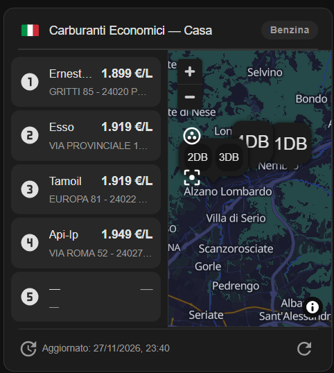

# Carburanti Economici Italia ⛽🇮🇹

[](https://my.home-assistant.io/redirect/hacs_repository/?owner=ivhazu&repository=carburanti_economici_ha&category=integration)
[](https://my.home-assistant.io/redirect/config_flow_start/?domain=carburanti_economici)

[](https://github.com/hacs/integration)
[](https://github.com/ivhazu/carburanti_economici_ha/releases)
[](https://github.com/ivhazu/carburanti_economici_ha/actions/workflows/validate.yml)
[](LICENSE)
[](https://www.home-assistant.io/)
[](https://claude.ai)

**[Italiano](#italiano) · [English](#english)**

| Configuration / Configurazione | Lovelace card |
|:-:|:-:|
|  |  |

---

## Italiano

**Carburanti Economici Italia** è una integrazione per Home Assistant che trova i distributori di carburante più economici vicino a una zona o a un device tracker, usando i dati ufficiali del Ministero delle Imprese e del Made in Italy (MIMIT).

> 🤖 Questa integrazione è stata sviluppata interamente da [Claude](https://claude.ai) (Anthropic). Idea, test e pubblicazione sono di [@ivhazu](https://github.com/ivhazu).

### ✨ Funzionalità

- 📍 **Zone e device tracker**: cerca vicino a qualsiasi zona HA o segui la posizione di un veicolo o di una persona
- ⛽ **Benzina, Diesel (Gasolio) e GPL**, selezionabili singolarmente
- 🏆 **Fino a 5 distributori** per carburante, con entità separate (1°, 2°, 3°…)
- 📏 **Raggio** da 1 a 50 km e **filtro anzianità prezzi** (0 = solo prezzi recenti)
- 📥 **Sorgente CSV open data** (consigliata): un solo download al giorno, senza errori 429; ripiega sull'API se il CSV non è disponibile
- 🕒 **Aggiornamento automatico** a un orario scelto, ogni N giorni, oppure **solo manuale**
- 🔄 **Pulsante di aggiornamento** per ogni istanza
- 🗺️ **Card Lovelace inclusa**: lista prezzi e mappa con pin numerati, aggiornamento automatico della vista e pulsante di refresh
- 🧹 **Pulizia automatica** di dispositivi ed entità quando riduci carburanti o distributori
- 🔧 Tutto configurabile dalla UI, nessun YAML

### 📥 Installazione

**HACS (consigliato)**

1. Premi il pulsante **Add to HACS** in cima a questa pagina, oppure in HACS → menu ⋮ → *Repository personalizzati* aggiungi `https://github.com/ivhazu/carburanti_economici_ha` come **Integrazione**
2. Scarica **Carburanti Economici Italia** e riavvia Home Assistant
3. Premi **Add integration** in cima a questa pagina, oppure *Impostazioni → Dispositivi e servizi → Aggiungi integrazione*

> L'integrazione non è (ancora) nel catalogo predefinito di HACS: il pulsante la aggiunge come repository personalizzato.

**Manuale**: copia `custom_components/carburanti_economici/` in `config/custom_components/` e riavvia.

### ⚙️ Configurazione

| Campo | Descrizione | Default |
|-------|-------------|---------|
| Tipo sorgente | Zona o device tracker | Zona |
| Zona / Device tracker | Da dove prendere le coordinate | — |
| Raggio (km) | Raggio di ricerca | 10 |
| N° distributori | Quanti distributori importare (1-5) | 1 |
| Anzianità prezzi (giorni) | Scarta prezzi più vecchi; 0 = solo oggi (con il CSV: oggi e ieri) | 7 |
| Sorgente dati | CSV open data (con ripiego su API) oppure solo API | CSV |
| Modalità aggiornamento | Automatico giornaliero o solo manuale | Automatico |
| Orario / ogni N giorni | Quando aggiornare. Con il CSV scegli dopo le 8:00 | 08:30 / 1 |
| Benzina, Diesel, GPL | Carburanti da cercare | Benzina, Diesel |

Ogni zona o device tracker si può configurare una sola volta. Le installazioni create prima della v1.5 restano sull'API finché non cambi la *Sorgente dati* dalle opzioni.

### 📊 Dati

- **CSV open data MIMIT** (anagrafica impianti e prezzi, aggiornato ogni mattina): una sola richiesta al giorno. I prezzi possono avere fino a un giorno di ritardo.
- **API `carburanti.mise.gov.it`**: dati più freschi, ma una chiamata per ogni distributore, con limiti (errore 429). L'integrazione ritenta con attese crescenti.

Prezzi **self-service** ove disponibili, altrimenti prezzo servito. Dati forniti dai gestori ai sensi della Legge 99/2009.

### 🔧 Entità

Per ogni *zona/tracker + carburante + posizione* vengono create 5 entità:

| Entità | Descrizione |
|--------|-------------|
| `sensor.distributore_1deg_benzina_home_prezzo` | Prezzo (€/L) |
| `sensor.distributore_1deg_benzina_home_nome` | Nome del distributore |
| `sensor.distributore_1deg_benzina_home_indirizzo` | Indirizzo (con `latitude`, `longitude` e immagine del pin) |
| `sensor.distributore_1deg_benzina_home_marchio` | Marchio |
| `sensor.distributore_1deg_benzina_home_aggiornamento` | Data di aggiornamento del prezzo |
| `button.aggiorna_carburanti_home` | Aggiorna subito i dati |

Il sensore `_prezzo` di rango 1 espone anche attributi diagnostici: `last_api_call`, `data_source` (sorgente realmente usata), `last_error` (ultimo errore) e `warnings` (ad esempio "2/5 distributori recenti: aumenta raggio o anzianità").

### 🗺️ Card Lovelace

La card viene registrata automaticamente. Se non compare tra le schede, aggiungila in *Impostazioni → Dashboard → Risorse* con URL `/carburanti_economici/carburanti-economici-card.js` e tipo **Modulo JavaScript**.

```yaml
type: custom:carburanti-economici-card
entities:
  - sensor.distributore_1deg_benzina_home_prezzo
  - sensor.distributore_2deg_benzina_home_prezzo
  - sensor.distributore_3deg_benzina_home_prezzo
```

Mostra bandiera, zona e carburante, la lista con marchio, prezzo e indirizzo, la mappa (card `map` nativa) e la data dell'ultimo aggiornamento con il pulsante di refresh. Si aggiorna da sola e su schermi stretti la mappa passa sotto la lista. L'editor grafico è disponibile dalla UI.

**Pin della mappa.** Di default il pin è un badge neutro con la sigla del marchio e la posizione in classifica. Per usare i **loghi** dei marchi, copia le immagini in `config/www/carburanti_economici/logos/` chiamandole come il marchio in minuscolo con `_` al posto di spazi e simboli: `esso.png`, `q8.png`, `agip_eni.png`, `api_ip.png`, `pompe_bianche.png` (il nome del marchio è nello stato del sensore `_marchio`). Formati: png, svg, webp, jpg. Se la cartella `www` non esisteva, riavvia una volta Home Assistant. I loghi non sono inclusi nel repository perché appartengono ai rispettivi proprietari.

### 📋 Requisiti e problemi noti

- Home Assistant **2024.7** o superiore, connessione internet, almeno una zona o un device tracker con coordinate
- I prezzi dipendono da quando i gestori li comunicano: usa il filtro anzianità
- La registrazione automatica della risorsa Lovelace può non riuscire su alcune versioni di HA (workaround sopra)
- La sorgente CSV è recente: se qualcosa non torna, controlla `data_source`, `last_error` e `warnings`, e apri una issue

### 🤝 Contributi e licenza

Issue e PR sono benvenute. Licenza MIT, vedi [LICENSE](LICENSE). Grazie a **MIMIT** per i dati aperti, a **Claude** per lo sviluppo e a **@ivhazu** per test e pubblicazione.

---

## English

**Carburanti Economici Italia** is a Home Assistant integration that finds the cheapest fuel stations near a zone or a device tracker, using the official open data of the Italian Ministry of Enterprises and Made in Italy (MIMIT).

> 🤖 This integration was developed entirely by [Claude](https://claude.ai) (Anthropic). Idea, testing and publishing by [@ivhazu](https://github.com/ivhazu).

### ✨ Features

- 📍 **Zones and device trackers**: search near any HA zone or follow a vehicle or person
- ⛽ **Petrol, Diesel and LPG**, individually selectable
- 🏆 **Up to 5 stations** per fuel, as separate entities (1st, 2nd, 3rd…)
- 📏 **Radius** from 1 to 50 km and a **price age filter** (0 = recent prices only)
- 📥 **CSV open-data source** (recommended): one download per day, no 429 errors; falls back to the API if the CSV is unavailable
- 🕒 **Automatic updates** at a chosen time every N days, or **manual only**
- 🔄 **Refresh button** for each instance
- 🗺️ **Bundled Lovelace card**: price list and map with numbered pins, auto-refreshing view and refresh button
- 🧹 **Automatic cleanup** of devices and entities when you reduce fuels or stations
- 🔧 Fully configurable from the UI, no YAML

### 📥 Installation

**HACS (recommended)**

1. Press the **Add to HACS** button at the top of this page, or in HACS → ⋮ menu → *Custom repositories* add `https://github.com/ivhazu/carburanti_economici_ha` as **Integration**
2. Download **Carburanti Economici Italia** and restart Home Assistant
3. Press **Add integration** at the top of this page, or go to *Settings → Devices & services → Add integration*

> The integration is not (yet) in the default HACS catalogue: the button adds it as a custom repository.

**Manual**: copy `custom_components/carburanti_economici/` to `config/custom_components/` and restart.

### ⚙️ Configuration

| Field | Description | Default |
|-------|-------------|---------|
| Source type | Zone or device tracker | Zone |
| Zone / Device tracker | Where the coordinates come from | — |
| Radius (km) | Search radius | 10 |
| Number of stations | How many stations to import (1-5) | 1 |
| Max price age (days) | Discard older prices; 0 = today only (with CSV: today and yesterday) | 7 |
| Data source | CSV open data (with API fallback) or API only | CSV |
| Update mode | Daily automatic or manual only | Automatic |
| Time / every N days | When to update. With CSV pick a time after 8:00 | 08:30 / 1 |
| Petrol, Diesel, LPG | Fuels to search | Petrol, Diesel |

Each zone or device tracker can be configured once. Installations created before v1.5 stay on the API until you change *Data source* in the options.

### 📊 Data

- **MIMIT open-data CSV** (station registry and prices, refreshed every morning): a single request per day. Prices can be up to a day old.
- **`carburanti.mise.gov.it` API**: fresher data, but one call per station and rate limits (429). The integration retries with increasing delays.

**Self-service** prices where available, otherwise the served price. Data is provided by station operators under Italian Law 99/2009.

### 🔧 Entities

For each *zone/tracker + fuel + rank* five entities are created:

| Entity | Description |
|--------|-------------|
| `sensor.distributore_1deg_benzina_home_prezzo` | Price (€/L) |
| `sensor.distributore_1deg_benzina_home_nome` | Station name |
| `sensor.distributore_1deg_benzina_home_indirizzo` | Address (with `latitude`, `longitude` and the pin image) |
| `sensor.distributore_1deg_benzina_home_marchio` | Brand |
| `sensor.distributore_1deg_benzina_home_aggiornamento` | Price update date |
| `button.aggiorna_carburanti_home` | Refresh now |

The rank-1 `_prezzo` sensor also exposes diagnostic attributes: `last_api_call`, `data_source` (the source actually used), `last_error` and `warnings` (e.g. "2/5 recent stations: increase radius or max age").

### 🗺️ Lovelace card

The card is registered automatically. If it does not show up in the card list, add it under *Settings → Dashboards → Resources* with URL `/carburanti_economici/carburanti-economici-card.js` and type **JavaScript module**.

```yaml
type: custom:carburanti-economici-card
entities:
  - sensor.distributore_1deg_benzina_home_prezzo
  - sensor.distributore_2deg_benzina_home_prezzo
  - sensor.distributore_3deg_benzina_home_prezzo
```

It shows the flag, zone and fuel, the list with brand, price and address, the map (native `map` card) and the last update time with a refresh button. It updates itself and, on narrow screens, the map moves below the list. A visual editor is available in the UI.

**Map pins.** By default the pin is a neutral badge with the brand abbreviation and the rank. To use brand **logos**, copy the images to `config/www/carburanti_economici/logos/` named after the brand in lowercase with `_` instead of spaces and symbols: `esso.png`, `q8.png`, `agip_eni.png`, `api_ip.png`, `pompe_bianche.png` (the brand name is the state of the `_marchio` sensor). Formats: png, svg, webp, jpg. If the `www` folder did not exist, restart Home Assistant once. Logos are not bundled in the repository because they belong to their respective owners.

### 📋 Requirements and known issues

- Home Assistant **2024.7** or newer, internet access, at least one zone or a device tracker with coordinates
- Prices depend on when operators report them: use the age filter
- Automatic Lovelace resource registration may fail on some HA versions (workaround above)
- The CSV source is new: if something looks wrong, check `data_source`, `last_error` and `warnings`, and open an issue

### 🤝 Contributing and license

Issues and PRs are welcome. MIT license, see [LICENSE](LICENSE). Thanks to **MIMIT** for the open data, **Claude** for the development and **@ivhazu** for testing and publishing.
