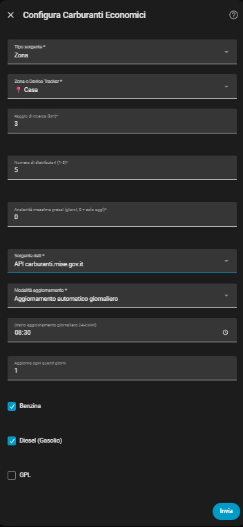

# Carburanti Economici Italia ⛽🇮🇹

[](https://my.home-assistant.io/redirect/hacs_repository/?owner=ivhazu&repository=carburanti_economici_ha&category=integration)
[](https://my.home-assistant.io/redirect/config_flow_start/?domain=carburanti_economici)

[](https://github.com/hacs/integration)
[](https://github.com/ivhazu/carburanti_economici_ha/releases)
[](https://github.com/ivhazu/carburanti_economici_ha/actions/workflows/validate.yml)
[](LICENSE)
[](https://www.home-assistant.io/)
[](https://claude.ai)

🇮🇹 **[Leggi in italiano → README.it.md](README.it.md)**

| Configuration | Lovelace card |
|:-:|:-:|
|  |  |

---

**Carburanti Economici Italia** is a Home Assistant integration that finds the cheapest fuel stations near a zone or a device tracker, using the official open data of the Italian Ministry of Enterprises and Made in Italy (MIMIT).

> 🤖 This integration was developed entirely by [Claude](https://claude.ai) (Anthropic). Idea, testing and publishing by [@ivhazu](https://github.com/ivhazu).

## ✨ Features

- 📍 **Zones and device trackers**: search near any HA zone or follow a vehicle or person
- ⛽ **Petrol, Diesel and LPG**, individually selectable
- 🏆 **Up to 5 stations** per fuel, as separate entities (1st, 2nd, 3rd…)
- 📏 **Radius** from 1 to 50 km and a **price age filter** (0 = recent prices only)
- 📥 **CSV open-data source** (recommended): one download per day, no 429 errors; falls back to the API if the CSV is unavailable
- 🕒 **Automatic updates** at a chosen time every N days, or **manual only**
- 🔄 **Refresh button** for each instance
- 🗺️ **Bundled Lovelace card**: price list and map with numbered pins, auto-refreshing view and refresh button
- 🧹 **Automatic cleanup** of devices and entities when you reduce fuels or stations
- 🔧 Fully configurable from the UI, no YAML

## 📥 Installation

**Marketplace (Home Assistant 2026.11 or newer)**

1. Press the **Add to HACS** button at the top of this page (on 2026.11+ it opens the Marketplace), or go to *Settings → Marketplace*, press **Add from link** and enter `ivhazu/carburanti_economici_ha` (adding a custom repository requires connecting a GitHub account)
2. Open **Carburanti Economici Italia** and press **Install**. Restart Home Assistant only if it asks you to
3. Press **Add integration** at the top of this page, or go to *Settings → Devices & services → Add integration*

**HACS (Home Assistant 2026.10 or older)**

1. In HACS → ⋮ menu → *Custom repositories* add `https://github.com/ivhazu/carburanti_economici_ha` as **Integration**
2. Download **Carburanti Economici Italia** and restart Home Assistant
3. Add the integration as above

> The integration is not (yet) in the default catalogue: it is added as a custom repository. HACS cannot be installed on Home Assistant 2026.11+, where the Marketplace replaces it.

**Manual**: copy `custom_components/carburanti_economici/` to `config/custom_components/` and restart.

## ⚙️ Configuration

| Field | Description | Default |
|-------|-------------|---------|
| Source type | Zone or device tracker | Zone |
| Zone / Device tracker | Where the coordinates come from | — |
| Radius (km) | Search radius | 10 |
| Number of stations | How many stations to import (1-5) | 1 |
| Max price age (days) | Discard older prices; 0 = today only (with CSV: today and yesterday) | 7 |
| Data source | CSV open data (with API fallback) or API only | CSV |
| Update mode | Daily automatic or manual only | Automatic |
| Time / every N days | When to update. With CSV pick a time after 8:00 | 08:30 / 1 |
| Petrol, Diesel, LPG | Fuels to search | Petrol, Diesel |

Each zone or device tracker can be configured once. Installations created before v1.5 stay on the API until you change *Data source* in the options.

## 📊 Data

- **MIMIT open-data CSV** (station registry and prices, refreshed every morning): a single request per day. Prices can be up to a day old.
- **`carburanti.mise.gov.it` API**: fresher data, but one call per station and rate limits (429). The integration retries with increasing delays.

**Self-service** prices where available, otherwise the served price. Data is provided by station operators under Italian Law 99/2009.

## 🔧 Entities

For each *zone/tracker + fuel + rank* five entities are created:

| Entity | Description |
|--------|-------------|
| `sensor.distributore_1deg_benzina_home_prezzo` | Price (€/L) |
| `sensor.distributore_1deg_benzina_home_nome` | Station name |
| `sensor.distributore_1deg_benzina_home_indirizzo` | Address (with `latitude`, `longitude` and the pin image) |
| `sensor.distributore_1deg_benzina_home_marchio` | Brand |
| `sensor.distributore_1deg_benzina_home_aggiornamento` | Price update date |
| `button.aggiorna_carburanti_home` | Refresh now |

The rank-1 `_prezzo` sensor also exposes diagnostic attributes: `last_api_call`, `data_source` (the source actually used), `last_error` and `warnings` (e.g. "2/5 recent stations: increase radius or max age").

## 🗺️ Lovelace card

The card is registered automatically. If it does not show up in the card list, add it under *Settings → Dashboards → Resources* with URL `/carburanti_economici/carburanti-economici-card.js` and type **JavaScript module**.

```yaml
type: custom:carburanti-economici-card
entities:
  - sensor.distributore_1deg_benzina_home_prezzo
  - sensor.distributore_2deg_benzina_home_prezzo
  - sensor.distributore_3deg_benzina_home_prezzo
```

It shows the flag, zone and fuel, the list with brand, price and address, the map (native `map` card) and the last update time with a refresh button. It updates itself and, on narrow screens, the map moves below the list. A visual editor is available in the UI.

**Map pins.** By default the pin is a neutral badge with the brand abbreviation and the rank. To use brand **logos**, copy the images to `config/www/carburanti_economici/logos/` named after the brand in lowercase with `_` instead of spaces and symbols: `esso.png`, `q8.png`, `agip_eni.png`, `api_ip.png`, `pompe_bianche.png` (the brand name is the state of the `_marchio` sensor). Formats: png, svg, webp, jpg. If the `www` folder did not exist, restart Home Assistant once. Logos are not bundled in the repository because they belong to their respective owners.

## 📋 Requirements and known issues

- Home Assistant **2024.7** or newer, internet access, at least one zone or a device tracker with coordinates
- Prices depend on when operators report them: use the age filter
- Automatic Lovelace resource registration may fail on some HA versions (workaround above)
- The CSV source is new: if something looks wrong, check `data_source`, `last_error` and `warnings`, and open an issue

## 🤝 Contributing and license

Issues and PRs are welcome. MIT license, see [LICENSE](LICENSE). Thanks to **MIMIT** for the open data, **Claude** for the development and **@ivhazu** for testing and publishing.
